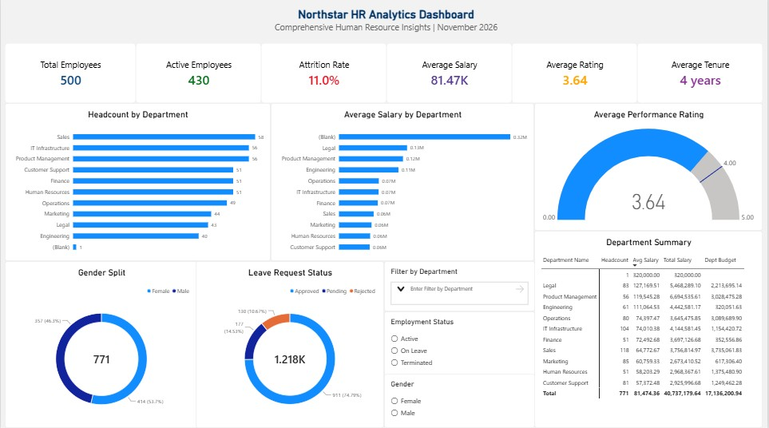
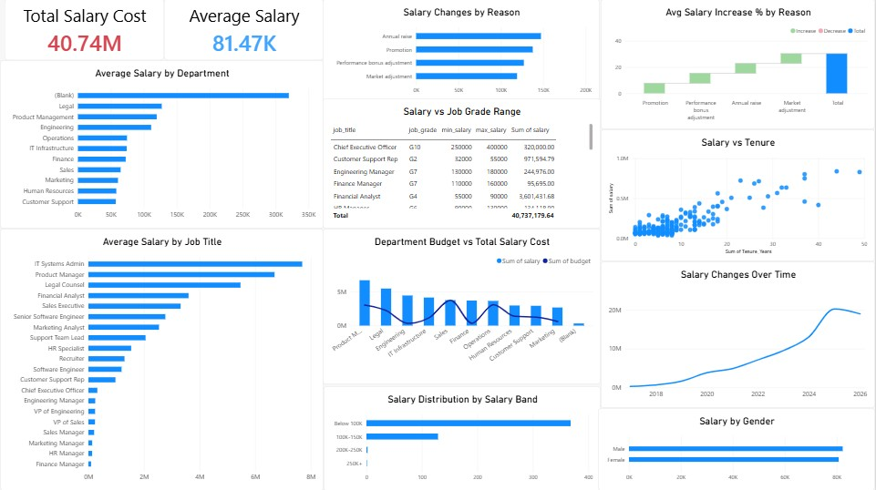
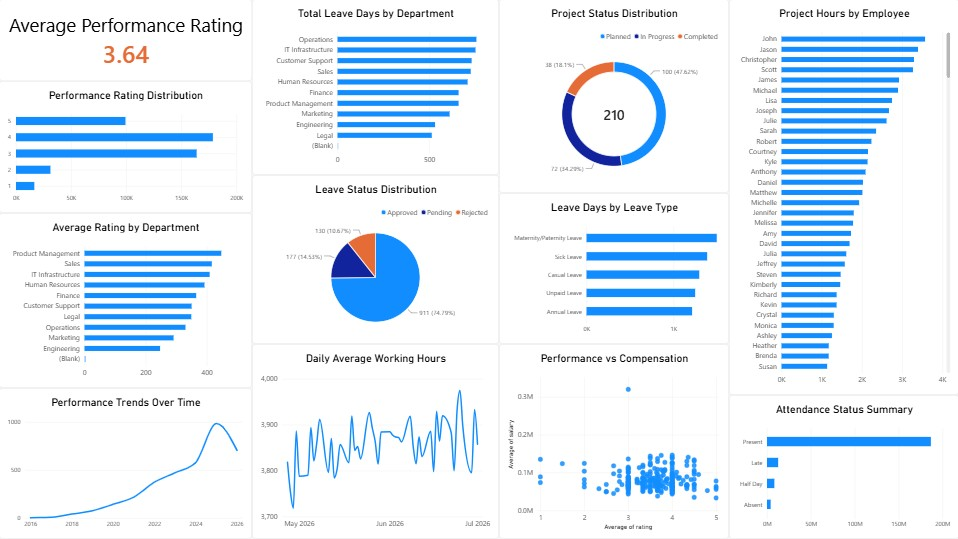

# Northstar HR Analytics Dashboard

**Data-Driven Human Resource Insights**

An interactive Power BI dashboard that provides comprehensive workforce analytics for Northstar — covering headcount, compensation, performance, leave & attendance, and project management across 5 global locations.

**Course:** Data Analytics, CDIP UIU  
**Instructor:** Md. Istiak Sarwar  
**Author:** Md Mahamudul Hasan  
**Date:** November 2026

---

## Project Overview

Northstar HR Analytics Dashboard transforms raw HR data into actionable insights for leadership. Built on a star-schema data model with 10 related tables, the dashboard enables interactive exploration of:

- Workforce composition & demographics
- Compensation structure and salary trends
- Performance ratings by department
- Leave patterns and attendance
- Project status and resource allocation

### Key Metrics at a Glance

| Metric                  | Value          |
|-------------------------|----------------|
| Total Employees         | 500            |
| Active Employees        | 430            |
| Terminated Employees    | 55             |
| Attrition Rate          | 11.0%          |
| Average Salary          | BDT 81.47K     |
| Average Performance     | 3.64 / 5       |
| Average Tenure          | 4 years        |
| Gender Split            | 52% Male / 48% Female |
| Total Salary Cost       | BDT 40.74M     |

---

## Dashboard Pages

The report contains **4 interactive pages** with 40+ visualizations:

| # | Page Name              | Focus                                      |
|---|------------------------|--------------------------------------------|
| 1 | HR Overview            | Workforce summary, headcount, attrition, demographics |
| 2 | Compensation & Salary  | Salary by department/role, salary bands, growth trends |
| 3 | Performance, Leave & Attendance | Ratings, leave types, working hours, attendance |
| 4 | Executive Dashboard    | Complete high-level view (hero page)       |

---

## Screenshots

> All screenshots are stored in the `images/` folder.

### Executive Dashboard (Hero View)

### Salary & Compensation Insights

### Performance Management

---

## Dataset Description

**Source:** Northstar HR Analytics Workbook

| Dimension              | Details                                      |
|------------------------|----------------------------------------------|
| Employees              | 500                                          |
| Departments            | 10                                           |
| Job Roles              | 20 (with salary grades)                      |
| Office Locations       | 5 (Dhaka, Chattogram, Singapore, London, New York) |
| Related Tables         | 10                                           |

### Tables Covered
- Employee demographics
- Departments & locations
- Job roles & salary grades
- Salary history
- Performance reviews
- Projects
- Leave records
- Attendance

### Data Model
- **Schema type:** Star schema  
- **Central table:** Employees (fact)  
- **Relationships:** 10 relationships across 10 tables  

---

## Key Insights

1. **Attrition** – Overall attrition rate is **11.0%**. Targeted retention programs recommended for high-attrition departments.
2. **Compensation** – Clear salary disparity exists across departments. Executive Office and Legal lead in average compensation; Customer Support and HR are at the lower end.
3. **Performance** – Company-wide average rating is **3.64 / 5**. There is room for improvement through structured feedback cycles.
4. **Leave Patterns** – Sick leave forms a significant portion of total leave days. Wellness initiatives could help reduce absenteeism.
5. **Projects** – A large share of projects remain “In Progress”. Better tracking and deadline management is needed.

---

## Recommendations

| Area                | Recommendation                              |
|---------------------|---------------------------------------------|
| Retention           | Implement targeted retention programs in high-attrition departments |
| Compensation        | Conduct a salary benchmarking exercise across departments and roles |
| Performance         | Introduce quarterly feedback cycles         |
| Wellness            | Launch an employee wellness program to address high sick leave |
| Project Delivery    | Improve project management tracking and accountability |

---

## Tools & Methodology

### Tools Used
- **Microsoft Power BI Desktop** – Data modeling, DAX, visualization
- **Microsoft Excel** – Source data preparation
- **Microsoft PowerPoint** – Presentation

### Approach
1. **Data Loading & Cleaning** – Power Query
2. **Data Modeling** – Star schema with 10 relationships
3. **DAX Development** – 13 custom measures + 6 calculated columns
4. **Dashboard Design** – 4 pages, 40+ interactive visuals

---

## How to Open the Dashboard

1. Download / clone this repository
2. Open the `.pbix` file with **Power BI Desktop**
3. Ensure the data source path is correctly mapped (or use the provided Excel/CSV files)
4. Refresh the data if needed
5. Explore the interactive pages and filters

> **Note:** Power BI Desktop is required to open and interact with the `.pbix` file.

---

---

## Author

**Md Mahamudul Hasan**  
BSc in Computer Science and Engineering  
Dhaka International University (DIU)  

**Course:** Data Analytics – CDIP UIU  
**Instructor:** Md. Istiak Sarwar  

---

## License

This project is created for academic purposes as part of the Data Analytics course at CDIP UIU. Feel free to use it for learning and portfolio purposes with proper attribution.

---

**Thank you for viewing this project!**  
Questions & feedback are welcome.
